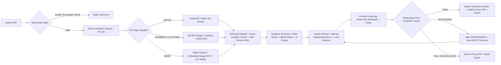

# System Architecture & Design

> **Status:** Approved target system design for the **PII Detection & Secure PDF Redaction MVP**. Current repository code covers configuration, model registry, safe logging, Docker scaffolding, ML evaluation/checkpoints, and a minimal frontend login preview (see [Executable Owners](#7-executable-owners--navigation)). Application services (`api`, `worker`, `ml-service`, reviewer UI, redaction, and verification) are scheduled for implementation in the linked stateful plan.

## 1. Product Intent, Constraints & Non-Goals

The system lets authenticated reviewers upload bilingual **Vietnamese and English** PDFs, automatically locate printed PII across native, scanned/flattened, and mixed pages, review and add manual boxes for handwriting/signatures, and export a **format-preserving destructively redacted PDF** gated by an independent security verifier.

### Hard Constraints
- **100% self-hosted, CPU-only:** Zero outbound internet calls at runtime (no cloud OCR, no external LLM/NER APIs). All containers run on a private server; base deployment fits modest RAM (`lightweight_cpu`), with an optional high-RAM Compose override (`opf_high_ram`) when `>= 16 GB` RAM is available.
- **Bilingual Vietnamese + English:** Both languages are first-class inputs and may appear on the same page.
- **Human-in-the-loop & fail-closed:** Every document requires visual review before locking an export snapshot (including documents with zero detected PII). Any failed page, unreviewed residual candidate, or mandatory verification failure blocks export.
- **Licensing:** PyMuPDF (`>= 1.25.0, < 2.0`, AGPL-3.0) is accepted for this deployment.

### Explicit Non-Goals
- Automatic OCR or PII detection for **handwriting or signatures** (always boxed manually in the reviewer UI).
- Non-PDF input formats (`DOCX`, images, spreadsheets) or cracking password-encrypted PDFs.
- Visual replacement tags (e.g., `[EMAIL]`) inside the PDF or full-page rasterized PDF output.
- Certifying "zero PII anywhere in the document" — verification proves selected regions are destructively erased and flags detectable residuals, never 100% recall.

---

## 2. Input Contract & Intake Boundary

Inputs are restricted to `application/pdf` within size, page-count, and timeout limits owned by [config/system_config.py](../config/system_config.py).

- **Hard intake gate:** `api` streams uploads to temporary quarantine storage (aborting immediately on size overflow or missing `%PDF-` magic bytes) without invoking native PDF parsers on the external-network container. Deep structural validation (encryption, xref integrity, and PDF bombs) runs inside an isolated, scrubbed-environment child process in the zero-egress `worker` container before committing the document for analysis.
- **Mandatory rejections:** Non-PDF magic bytes, password-encrypted PDFs, corrupted xref tables, zero-page files, and PDF resource bombs (excessive xref object counts, abnormal stream decompression ratios, or oversized embedded raster pixel dimensions) are rejected with structured errors and zero persisted artifacts.
- **Immutability:** Accepted originals are stored under server-generated UUID paths in private storage with a `SHA-256` checksum and are never mutated.

---

## 3. End-to-End Workflow & Page-Level 3-Way Routing

### Input Type -> Extraction -> Output Matrix

| Page Input Type | Classification Signal | Extraction / OCR Workflow | Redaction & Output Behavior |
|---|---|---|---|
| **Native (Plain-Text) Page** | Extractable visible text (`type != 3` and `opacity > 0` in `get_texttrace()`); no qualifying raster images | Direct PyMuPDF char/word extraction (`set_small_glyph_heights(True)`), reading order, and exact offsets — no OCR | Permanently delete PII glyphs from content stream + draw solid black box; non-PII text stays selectable and searchable |
| **Scanned / Flattened Page** *(incl. stale invisible OCR layer)* | Full-page raster image with negligible visible text, **or** raster covered only by invisible `render_mode == 3` text | Ignore untrusted invisible OCR layer; render `CropBox` at 300 DPI, deskew, run offline VI+EN OCR, inverse-transform polygons to visual PDF coords | Zero/black-out image pixels in region + strip invisible `3 Tr` OCR layer; no hidden selectable text survives |
| **Mixed Page** | Visible native text **plus** embedded raster images (e.g., pasted ID card, scanned receipt) | Run native extraction on text streams **and** OCR on embedded image crops; merge & deduplicate overlaps by IoU while preserving provenance (`native` vs. `ocr`) | Delete native PII vector text **and** zero/black-out embedded image pixels (decoupling reused image XObjects first) |
| **Handwriting / Signature** | Visual-only (excluded from auto-OCR) | Reviewer draws manual box in safe preview viewer | Redacted identically to approved regions (vector + pixel + outlined-path removal) |

**Rejected alternative — binary file-level routing (`plain-text OR flattened`):** Rejected because real business PDFs frequently combine digital cover sheets with scanned appendices, embed scanned ID images inside native pages, or carry misaligned/diacritic-broken scanner OCR layers (`3 Tr`). Treating any of those as plain-text-only silently leaks PII.

---

## 4. Output Contract & Fail-Closed Guarantees

A successful export produces two bound artifacts tied to `(document_id, revision_id, pipeline_version, model_version)`:

1. **Format-Preserving Redacted PDF:**
   - Solid black boxes `(0, 0, 0)` with underlying vector text, intersecting vector/outlined paths (for manual/outlined regions), overlapping raster pixels, and stale `3 Tr` OCR text permanently destroyed.
   - Non-redacted native text remains selectable, searchable, and visually intact with identical page count and dimensions.
   - Hidden data purged across catalog, page, and indirect objects (Info/XMP `/Metadata`, `/PieceInfo`, annotations/comments, `/AcroForm`/widgets, `/EmbeddedFiles`, `/JavaScript`/`/OpenAction`/`/AA`/`/URI`/`/Launch`, `/Outlines`, `/StructTreeRoot`, `/DSS`, `/XFA`, thumbnails, hidden `/OCProperties` streams) and written non-incrementally (`garbage=4`, single `%%EOF`).
2. **PII-Free Verification Report (UI + JSON):**
   - Aggregates mandatory independent checks (`VER-01` text, `VER-02` pixel & CTM-mapped raw image & crop re-OCR, `VER-03` structure/hidden-data/`%%EOF`, `VER-04` integrity) plus `VER-06` residual PII scan into `PASS`, `FAIL`, or `INCONCLUSIVE`.
   - Never contains raw leaked PII strings (only check codes, page numbers, region IDs, leak counts, and normalized text hashes).
   - **Fail-closed:** Any `FAIL`, `INCONCLUSIVE`, or newly discovered unreviewed residual candidate discards the temp PDF and blocks download.

**Rejected output alternatives:**
- *Full-page rasterized PDF output:* Simpler leak prevention, but destroys text search/selection on digital contracts and inflates file size.
- *Replacement tags (`[EMAIL]`, `[IDCARDNUM]`) inside the PDF:* Breaks layout alignment on rotated/tight-spaced lines and leaks entity-type metadata visually.

---

## 5. Invariants & Variation Points

### Seam 1: Page Extraction & Canonical Coordinate Frame (`NATIVE` vs. `SCANNED_FLATTENED` vs. `MIXED`)
- **Why this seam exists:** Native PDFs yield exact font/glyph geometry while scanned/mixed regions yield deskewed pixel polygons with OCR confidence. Keeping extraction behind a single `PageIR` contract isolates downstream detection, UI rendering, redaction, and verification from how text was acquired while keeping `native` vs. `ocr` provenance and confidences explicitly distinct (never pretending they share identical primitives).
- **Coordinate invariant:** All persisted regions and viewer overlays use **visual (rotated) top-left `CropBox` points** (`rect_visual = rect_unrotated * page.rotation_matrix`). React (`SVG viewBox`), `pdfplumber` (`VER-01`), and `pdftoppm -cropbox` (`VER-02`) share this exact frame directly; PyMuPDF `add_redact_annot()` converts on entry via `page.derotation_matrix`, and OpenCV deskew matrices transpose their 2×2 block when converting to PyMuPDF row-vector matrices.
- **Offset invariant:** Entity spans map to PDF bounding boxes strictly via `char_offset -> token_ids -> multi-line rects[]`. Relocating matches via `page.search_for()` is rejected because duplicate strings, whitespace normalization, and line wraps cause wrong-occurrence highlights and missed spans.
- **OCR engine choice & rejected alternative:** Day-1 OCR uses **Tesseract 5 (`vie+eng`, `tessdata_best`)** because it is already apt-installable offline with complete coverage of Vietnamese compound diacritics at ~50–150 MB RAM. Stock RapidOCR/PaddleOCR `latin` models were rejected for Day 1 because upstream Latin dictionaries omit ~70 precomposed Vietnamese diacritics; a Vietnamese-tuned ONNX recognizer remains a documented contingency only if scanned benchmarks fail accuracy targets.

### Seam 2: Bilingual PII Detection & Model Serving (`VI` vs. `EN`; `lightweight_cpu` vs. `opf_high_ram`)
- **Why this seam exists:** Benchmark evidence proves zero-shot Vietnamese NER drops to `0.3528` exact F1 on English text ([evaluation/results/vn_benchmark_results.json](../evaluation/results/vn_benchmark_results.json)), while `opf_vn_19` peaks at `~4.09 GB` RAM on CPU (`vn_benchmark_results.json`) and English OPF peaks at `~3.63 GB` RAM ([evaluation/results/benchmark_results.json](../evaluation/results/benchmark_results.json)). Serving models inside a **single authenticated `ml-service` process** loads weights once in RAM while keeping PDF/OCR worker subprocesses cheap and killable on timeout or OOM.
- **Language routing & canonical taxonomy:** `ml-service` routes text blocks by language (`VI`, `EN`, or dual-pass for mixed-language blocks) and projects raw VI 19-label (`checkpoints/opf_vn_19_label_space.json`), EN 25-label (`GRAVITEE_25_LABELS`), and EN OPF 8-label (`OPF_TO_GRAVITEE_PRIMARY_MAP`, both in `evaluation/metrics.py`) outputs into **6 canonical UI groups** (`PERSON`, `EMAIL`, `PHONE`, `ADDRESS`, `DATE`, `ID_NUMBER`) while retaining `raw_label` in metadata. Every raw label must be explicitly mapped or listed in an audited `EXCLUDED_LABELS` set (`AGE`, `GENDER`, `SEX`, `TITLE`, `HONORIFIC`, `NRP`, `ORGANIZATION`, `URL`, `private_url`, `IP_ADDRESS`, `MAC_ADDRESS`, `IMEI`, `FINANCIAL` excluded by default; all government/financial IDs, `PASSWORD`, and OPF `secret` mapped to `ID_NUMBER`).
- **Profile split:** Base Compose builds default to `lightweight_cpu` (`spacy_vn_19_ner` + EN Presidio/`en_core_web_lg` + production rules, ~2 GB RAM, reproducible offline without multi-GB weights). Higher-accuracy dual-OPF serving (`opf_high_ram`, ~12 GB RAM) is supported via an optional mounted-weights Compose override.
- **Production rules rule:** Benchmark modules (`evaluation/hybrid_rules.py`, `evaluation/vn_rules.py`) contain dataset-specific shortcuts (structured-prefix NER short-circuits, key blacklists, score clobbering, and OPF-assumed Presidio filtering) that must **not** be invoked verbatim in production `ml-service`; clean production rules live separately and preserve raw uncalibrated NER scores.

### Seam 3: State, Immutable Revisions & Job Queue
- **Why PostgreSQL owns both state and jobs:** Using PostgreSQL `SELECT ... FOR UPDATE SKIP LOCKED` eliminates operating a separate Redis/Celery broker while giving single-transaction atomicity across job claims, review revision locks, and deletion tombstones.
- **Revision immutability invariant:** A `LOCKED` `review_revisions` row is **never** mutated back to `DRAFT`. Any post-lock edit — or any new unreviewed residual candidate surfaced by `VER-06` — marks the locked snapshot `SUPERSEDED` and inserts a new `DRAFT` (`revision_no + 1`), enforced by a partial unique index allowing at most one `DRAFT` per document.
- **Retry & deletion invariants:** Export idempotency uses a partial unique index on active/succeeded jobs so failed/cancelled jobs can be retried cleanly, bounded by `max_attempts` dead-lettering. All worker outputs (previews and exports) stage under temp job directories and move into private storage only under `SELECT ... FOR UPDATE` verifying `documents.deleted_at IS NULL`. Document deletion immediately sets `deleted_at`, purges PII-bearing child rows in PostgreSQL, kills active jobs, and wipes disk artifacts.

### Seam 4: Redaction Engine vs. Independent Verification Engine (`RED` vs. `VER`)
- **Zero-shared-code invariant:** `RED` uses PyMuPDF (`>= 1.25.0, < 2.0`), whereas `VER` is strictly forbidden from importing `pymupdf`/`fitz` (verified by automated AST import test) and relies exclusively on `pdfplumber`/`pdfminer.six`, `poppler-utils` (`pdftoppm`, `pdfimages`) via subprocess, and `pikepdf`/`qpdf`. A parser or redaction bug in MuPDF cannot hide itself from independent verification.
- **Critical PDF redaction invariants:** Shared image XObjects, shared `/SMask`s, shared `/Resources`, and shared Form XObjects must be decoupled (`xref_copy`) before pixel redaction so mutating Page A never corrupts or misses Page B. Hidden OCG streams must be stripped or rejected before deleting `/OCProperties` (deleting `/OCProperties` alone reveals hidden layers).
- **Residual loop anti-lockout invariant (`VER-06`):** Post-redaction scanning runs on **both** `pdfplumber` native text and full-page post-redaction OCR (`SCANNED_FLATTENED`/`MIXED` pages), matching previously user-rejected candidates by `page_no` + bounding-box IoU tolerance + normalized SHA-256 text hash so minor PyMuPDF-vs-`pdfplumber` glyph-height differences never cause an infinite re-review loop.

---

## 6. Component Topology & Security Boundaries

Four self-hosted Docker Compose services with strict network and filesystem isolation:

- **`api` (FastAPI + static React SPA):** Sole container bridged to the external/reverse-proxy network (`frontend_net`) plus `backend_internal`. Enforces fail-fast startup security checks (`validate_security(strict_runtime=True)`), Argon2id auth, revocable HttpOnly `SameSite=Lax` sessions, double-submit CSRF (`csrf_token` cookie + `X-CSRF-Token` header) + `Origin` validation, DB-backed login rate limiting, owner RBAC, and global `SafeFormatter` log scrubbing across root and framework loggers. Never invokes native PDF parsers directly (only streams size-capped `%PDF-` uploads to quarantine). Serves safe server-rendered preview PNGs (`CSP: default-src 'none'; img-src 'self'`) so untrusted PDFs never execute in the browser.
- **`postgres` (PostgreSQL 16, `backend_internal` only):** Relational state, `SKIP LOCKED` job queue, and PII-free `audit_logs`.
- **`worker` (`backend_internal` only, `internal: true` — zero internet egress):** Owns all native PDF parsing (deep intake validation, OCR, redaction, verification). Spawns clean `subprocess.Popen` (never `fork()`) processes with scrubbed environments (zero DB/JWT/ML secrets) and per-job staging paths, supervised by a non-blocking parent loop running `psutil` RSS caps, 30s lease heartbeats, and 5s deletion-tombstone cancellation kills. *(Note: same-UID subprocesses enforce secret scrubbing, path hygiene, OOM/timeout containment, read-only `/app`, and zero network egress; OS-level cross-tenant filesystem sandboxing via separate parser UIDs or per-job containers is a post-MVP hardening step.)*
- **`ml-service` (`backend_internal` only, bearer-token authenticated):** Singleton offline bilingual detector serving text chunks only (never touches raw PDFs or storage volumes).
- **Container hardening:** Root-owned read-only `/app`, `read_only: true` rootfs with `tmpfs` `/tmp`, `cap_drop: [ALL]`, `no-new-privileges: true`, and a named storage volume owned by the non-root runtime user.

---

## 7. Executable Owners & Navigation

| Concern | Authoritative Owner | Status |
|---|---|---|
| Runtime config, limits & security checks | [config/system_config.py](../config/system_config.py) | Implemented (extended in target design) |
| Model catalog & checkpoint verification | [configs/models.json](../configs/models.json), [config/model_registry.py](../config/model_registry.py) | Implemented (VN models; EN entries planned) |
| Safe logging & secret scanner | [config/logger.py](../config/logger.py), [scripts/check_secrets.py](../scripts/check_secrets.py) | Implemented (hardening planned) |
| Container & dev workflow | [docker/Dockerfile](../docker/Dockerfile), [docker-compose.yml](../docker-compose.yml), [Makefile](../Makefile) | Scaffolding implemented |
| Environment & version-control ops guide | [docs/ops/OPS-01-environment-and-version-control.md](./ops/OPS-01-environment-and-version-control.md) | Implemented (`DONE`) |
| ML evaluation & Vietnamese checkpoints | [evaluation/](../evaluation/), [checkpoints/](../checkpoints/) | Implemented |
| Frontend starter | [frontend/](../frontend/) | Login preview starter |
| **Stateful implementation plan (non-evergreen)** | [plans/261126-0104-bilingual-pdf-pii-system-design/plan.md](../plans/261126-0104-bilingual-pdf-pii-system-design/plan.md) | Validated, ready for execution |
| **Interactive workflow diagram (non-evergreen)** | [plans/reports/advise-261126-0054-system-design-preview.html](../plans/reports/advise-261126-0054-system-design-preview.html) | Proposed visual preview |
| **Team functional backlog (non-evergreen)** | [plans/261101-1815-mvp-function-breakdown/function-breakdown.md](../plans/261101-1815-mvp-function-breakdown/function-breakdown.md) | Reference work-package backlog |
